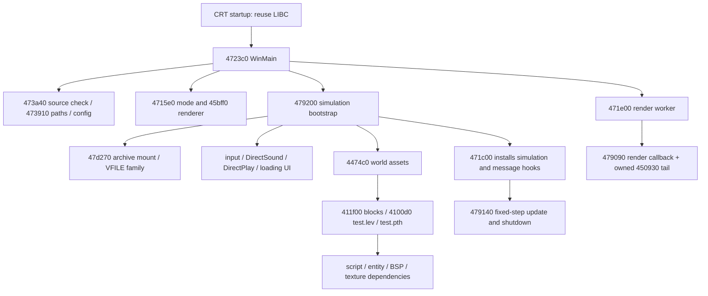

# M1 source-map and first-frontier review

Reviewed 2026-10-23 against the immutable English EXE (`c86205e299119a66e27f687679ee7e978f26fa9a6c0bfb21f664aa6e74e848b1`), using the existing Ghidra 12.1.4 database and read-only `tools/ReviewFrontier.java` exports. No binary bytes, Ghidra types, function boundaries or historical research reports were rewritten. Analytical names below are ours.

## Gate and scope

The initial M1 gate is satisfied for the **nine-function archive/VFILE recovery assignment** listed below. Each assigned entry has an inspected body boundary, provisional ABI checked against stack accesses/returns, an explicit owner, and classified direct dependencies. Startup, math, assets, renderer, simulation, audio, input and network roots have been surveyed so this assignment fits an observable path. This permits the next bounded M2 family; it is not a complete dynamic dependency closure for gameplay.

The catalog preserves all 887 observed function records. This pass records 57 manual frontier decisions, retains earlier math/CRT evidence and leaves 672 function records explicitly `unknown`. They are not assigned as gameplay implementations. The 243 code-pointer candidates retain their original status except where registration and body evidence is reviewed. The first-slice graph contains 370 nodes using observed calls plus selected reviewed callbacks; 159 reachable function records still have unknown provenance. Its 304 unresolved computed-transfer sites include COM methods and register-indirect calls, not 304 new game functions. Future recovery assignments must review their own boundaries and dependency owners before coding. Unknown ownership is not permission to omit required behavior.

Files:

- `role-catalog.json`: roles, confidence, owning review/module, observed body ranges, ABI limits and evidence per record; auxiliary data/tail records do not add recovered functions.
- `first-slice-dependencies.json`: observed callsites, specifically reviewed callback paths, unresolved computed transfers and next-family addresses.
- `abi-inventory.json`: globals, structures, callback slots, jump tables, COM storage and lifetime/numerical limits.
- `catalog-summary.json`: counts and input hashes, with no source-completion percentage.
- `review/`, `supplement/`, `runtime-extra/`: raw decompiler/disassembly/reference evidence. These are analysis artifacts, not candidate source implementations.

## Reviewed startup and scene path



The real supplied scene entry is observed as `test.lev`, with `test.pth` and `bsp\blocks.txt` referenced by `004474c0`. This is the first-scene dependency anchor, not a claim that a playable reference scenario or mission acceptance trace has been captured. That remains M3/M4 work.

Important indirect edges are now explicit: WinMain registers WNDPROC `00471ff0`, DirectDraw enumeration callbacks `00472270` and `00472330`, and worker `00471e00`. `00479120` installs render callback `00479090` through `00471df0`. `00479200` installs archive-progress callback `004791f0`, then clears it, and uses `00471c00` to install simulation callback `00479140` and application-message hook `00473c40`. The initial message hook is `00471be0`.

ABI distinction: OS WNDPROC/enumeration callbacks return with `RET 0x10`. The application hook at `00473c40` is **cdecl**, with a plain RET and cleanup in the wrapper. Do not copy the OS callback convention onto that hook. The source-check decompiler's apparent input parameter is also unreliable: its EAX-driven stack probe allocates `0x1030c` bytes and confuses recovered stack variables.

## False recovery targets and boundary corrections

| Address/range | Decision and evidence |
|---|---|
| `0047e730` | Full prior SP3 LIBC startup section match; reuse runtime startup/SEH, rather than recovering game startup scaffolding |
| `0047e680..0047e6ae` | `__chkstk`: page probing and ESP adjustment, also an existing COFF chkstk.obj match; compiler support |
| `004848b0`, `004848d0`, `004848f2`, `004849a8`, `00484a65`, `0047de20` | Verified unwind/exception/float-conversion support; excluded from game recovery |
| `0047dae0`, `0047db90`, `0047dc10`, `0047de50` | Complete normalized LIBC `malloc`, `free`, `fopen`, `printf` wrappers; use the runtime |
| `0047d660`, `0047d690`, `0047e930` | Complete normalized LIBC FP initialization/conversion-table/default-precision bodies |
| `0047d360`, `0047d366`, `0047d36c`, `0047d658` | Four six-byte JMP-through-IAT import thunks; PE import descriptor and instruction bytes checked |
| `0047d380..0047d657` | **Data**, not a continuous import-thunk/code range: 44 x 16-byte DirectInput object formats plus 24-byte format descriptor at `0047d640`; referenced by SetDataFormat call at `004712b6` |
| `00450930..00450978` | Noncontiguous tail already owned by `00479090`, reached by JMP at `00479111`; not an independent recovery function. Only that incoming jump was observed, so do not claim multiple owners |
| `0047d680` | One-byte RET shared by numerous callback slots. Recorded under shared code/tail role as a common sentinel, with authorship unresolved; no independent gameplay assignment or universal callback prototype |
| `00473d28`, `00473d40` | Application-message switch tables belonging to `00473c40`, not callbacks/functions |

The old reconnaissance's approximate `0047d360..0047d65f` “import-thunk area” description is superseded by the four-thunk/data distinction. Its historical record remains intact. Other unassigned gaps and unusual/discontiguous runtime bodies remain observations requiring owner review; proximity is not attribution.

`crt-frontier.json` records a bounded, single-library attribution investigation: seven complete observed bodies, actual COFF relocation operands only, alignment checked, existing `__setdefaultprecision` positive control, and an unmasked-byte corruption negative control for every body. It is relocation-normalized library evidence, not raw-byte/source recovery or a new implementation admission. The investigation stopped after the pinned SP3 LIBC.

## Library survey disposition

| Candidate | Evidence and disposition |
|---|---|
| VC5 SP3 single-threaded LIBC | Existing whole-section matches and new frontier-wrapper matches establish reuse. M0 already links this declared runtime. Preserve C ABI and historical FILE behavior where observed |
| Microsoft DirectX/Win32 interfaces and data formats | PE imports, COM GUIDs, callsites and local SDK layouts establish external platform dependencies. DirectInput data conforms to the SDK joystick-format layout; this does not uniquely identify the original SDK version |
| QvLib, RenderWare, BRender, Miles, Smacker, zlib, JPEG/PNG libraries | Earlier string/library scout establishes no positive attribution. Absence of strings and zero eligible static sections are not exclusion proof. No wholesale replacement is justified |
| Math, VFILE, image/BSP loading, scheduler/entity infrastructure | Retain `engine_candidate` where authorship is unknown. Behavioral reconstruction is still required if no compatible verified library is identified |
| VC5 C++/GLAUX/LARGEINT sampled libraries | Prior sampled code-section nonmatches are limited negative evidence, not a global library exclusion. No reusable engine source candidate has been verified |

Available verified dependencies are the supplied Microsoft runtime and SDK/interface definitions. There is still no established reusable open-source engine implementation. No broad renderer, input, audio or network backend replacement is admitted by this review.

## Next assigned family: archive/VFILE

Owner: `archive_vfile`. Intended translation unit: `src/bh_vfile.c` with shared checked declarations in `src/bh_vfile.h` (neither implemented by M1). Named integration target remains `build/m0/bhunter-integration.exe`. Work in small subfamilies, compiling/linking each before admission; do not create all nine implementations disconnected from tests.

| Address | Owned behavior |
|---|---|
| `0047d270` | mount directory/backing file and first-access state |
| `0047cbd0` | open: cache → loose file → archive; first-access callback |
| `0047ce50` | close/recycle wrapper and backend ownership |
| `0047cec0` | seek and reset EOF |
| `0047cf60` | bounded read and element-count semantics |
| `0047d230` | backend-specific tell |
| `0047cea0` | backend-specific EOF |
| `0047d050` | line read, newline pairing and cursor rollback |
| `0047ca70` | preload/register shared persistent memory handle |

All direct dependencies are now classified: this family calls the real CRT allocation/stdio/string routines, other members of the same family, and an optional progress callback. The game's progress callback is owned by `loading_ui`, not silently replaced by a success stub. Its actual rendering dependencies remain outside this first source-only archive checkpoint; a nullable production callback and isolated callback-contract tests can exercise the archive contract without claiming the UI is recovered.

The required owning state is enumerated at `004f95f8..004f9618` in `abi-inventory.json`. The 256-byte directory record, 32-byte wrapper and 256-byte preloaded-name node have separately described layouts. No globals or vtables should be guessed from decompiler names.

M2 contracts and checks needed before admission:

1. Start with mount/open/read/seek/tell/close, real owning state, checked arithmetic and cleanup. Validate every one of the 1,229 real directory entries and read representative payload bytes from each asset class. Reject truncated, overflowing, nonterminated or out-of-bounds directories without invalid reads; distinguish safe malformed-input rejection from fidelity on valid originals.
2. Test loose-file precedence, case-insensitive name lookup, archive read-only fallback, zero/EOF/partial element semantics, cursor clamping, independent archive wrappers sharing one FILE, and first-access notification/order exactly once per entry. Inspect division-by-zero/overflow and short-read edge behavior before adopting an API contract.
3. Admit preload and line-reading only with their own tests. Cached opens return the same wrapper and reset its cursor; close preserves cached data. CR/LF pair handling and end-of-entry overread risk need an explicit safe bounded contract. Do not copy unchecked read-ahead from the original into malformed-input handling.
4. Confirm mount failure/reload ownership and free-list/cache teardown. The original writes wrapper fields before some allocation checks, and mount does not visibly free every prior allocation. Preserve valid behavior; do not reproduce crashes/leaks as fake fidelity requirements. Record any safety deviations.
5. WinMain closes the shared archive FILE after bootstrap. Determine which later loads rely on preloaded data before admitting scene-level lifetimes. Preload/cache ownership and startup/shutdown phases are part of the behavior, not an incidental optimization.

The existing ten math routines keep their prior implementation status. Verified CRT startup selects x87 PC53 through `controlfp(0x10000,0x30000)`. This establishes an initial state only; precision changes in drivers, worker startup or simulation remain unverified and the five PC24 discrepancies remain open. CD audio track/timing behavior and active DirectPlay3A requirements also remain open.

## Reproduce and validate

```powershell
python tools/verify_crt_frontier.py
python tools/m1_catalog.py --check
.\build.cmd
python tools/m0.py verify-reference
```

The catalog check regenerates in memory and rejects drift, duplicate/missing manual decisions, invalid import/data shapes, or an assigned VFILE direct dependency whose role is still unknown. The source-only integration scenario and original-reference hashes must still pass. The M1 review does not promote any implementation, byte-match variant or game admission.
