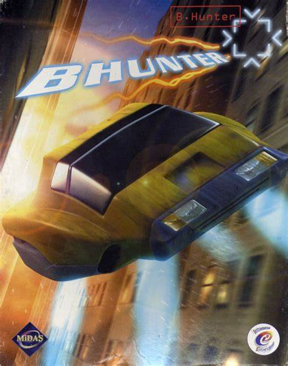
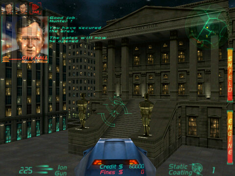
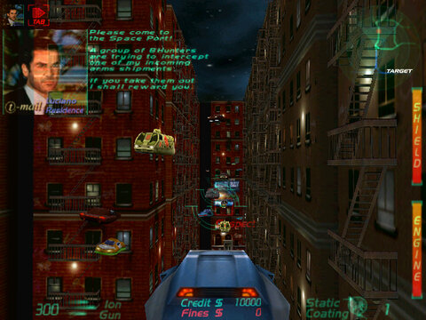
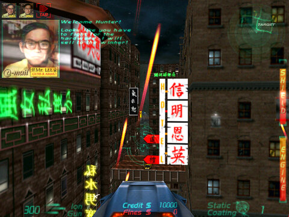
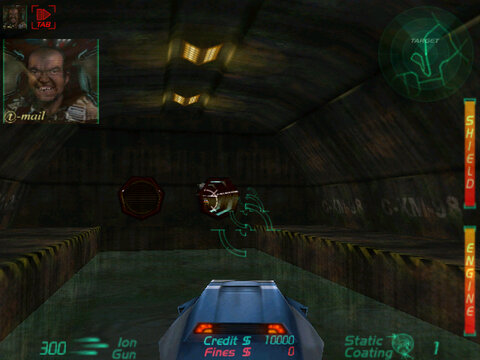
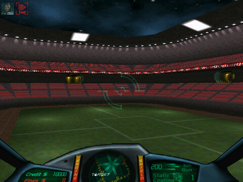
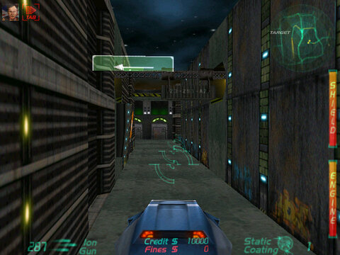
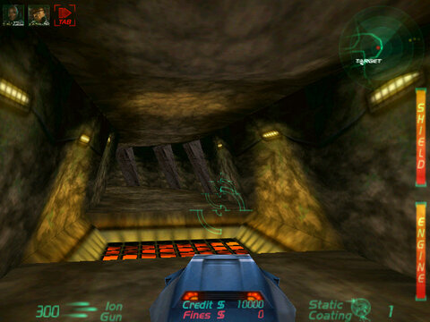
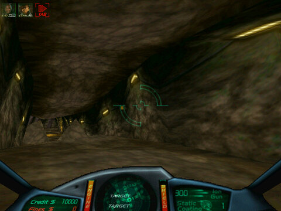
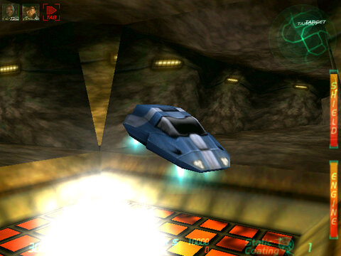

# BHunter

<p align="center">
  
</p>

<table>
  <tr>
    <td align="center"><a href="screenshots/BHunter-20261029-230509-088-1.jpg"></a></td>
    <td align="center"><a href="screenshots/BHunter-20261029-230621-253-2.jpg"></a></td>
    <td align="center"><a href="screenshots/BHunter-20261029-230700-576-3.jpg"></a></td>
  </tr>
  <tr>
    <td align="center"><a href="screenshots/BHunter-20261029-230715-224-4.jpg"></a></td>
    <td align="center"><a href="screenshots/BHunter-20261029-230812-238-5.jpg"></a></td>
    <td align="center"><a href="screenshots/BHunter-20261029-230838-789-6.jpg"></a></td>
  </tr>
  <tr>
    <td align="center"><a href="screenshots/BHunter-20261029-230940-826-7.jpg"></a></td>
    <td align="center"><a href="screenshots/BHunter-20261029-231029-578-8.jpg"></a></td>
    <td align="center"><a href="screenshots/BHunter-20261029-231036-260-9.jpg"></a></td>
  </tr>
</table>

A source restoration of **BHunter**, the 1999 hovercar combat game by **InterActive Vision**, published by **Midas Interactive Entertainment**. Hunt criminals through a futuristic city and collect their bounties. [Original game details](https://gamefaqs.gamespot.com/pc/250530-bhunter/data).

## Install

1. Download and extract [release 0.1](https://github.com/stellarwind/BHunter-revived/releases/tag/v0.1) on Windows.
2. Copy `Bhunter.bin` from your own original game into the `GAME_DATA` folder.
3. Run `BHunter-source.exe` (fullscreen hardware rendering by default). Later changes in the video settings take effect after restarting.

Music plays from a mounted BHunter CD, or from `MUSIC_DATA/track02.wav` beside `GAME_DATA`. 

Supported original game: **BHunter, English retail PC edition (1999)**. The tested files are:

| File | SHA-256 |
|---|---|
| `Bhunter.bin` | `2393a661fd647ed6de3eee34c35c30812c44f3ee15b9d44244a63720804df581` |
| `BHUNTER.EXE` (reference only) | `c86205e299119a66e27f687679ee7e978f26fa9a6c0bfb21f664aa6e74e848b1` |

See [How to play](HOWTOPLAY.md) for controls.

Original game files are not included. DDrawCompat is bundled for modern Windows compatibility. This is an early playable release; full original-game fidelity is still being reviewed.

## Build

Requires Python 3.10+, Visual C++ 5.0 with Visual Studio 97 SP3, and the DirectX 7 SDK. Proprietary build dependencies are not included.

Set these paths in a Command Prompt:

```bat
set BH_VC_ROOT=C:\VC5\VC
set BH_SP3_ROOT=C:\VS97SP3\all\vc
set BH_SHARED_DIR=C:\VC5\SHAREDIDE\BIN
set BH_DXSDK_ROOT=C:\DX7SDK
set BH_COMPILER_DIR=C:\BHunter-compiler
```

Prepare `BH_COMPILER_DIR` with stock VC5 `CL.EXE`, SP3 `c1.dll`, `c1xx.dll`, `c2.exe` (from `enu\vc\bin`), and stock `MSDIS100.DLL`, `MSPDB50.DLL`, `MSVCP50.DLL` (from `SHAREDIDE\BIN`). The build uses the stock VC5 linker and SP3 headers/libraries.

```bat
build-source.cmd
python tools\prepare_ddrawcompat.py
build\BHunter-source.exe
```

The build stages the executable and your local `GAME_DATA` and `MUSIC_DATA` into `build/`. The CFG lives beside the executable. Run from that folder, exactly like the release. To create a release ZIP:

```bat
python tools\package_release.py --version 0.1
```

## Unlock all levels

Quit the game, then run with Python 3.10+:

```bat
python tools\unlock_levels.py
```

This unlocks all nine mission entries in `source-preview.cfg` beside the executable (`build/source-preview.cfg` for local builds), backing up the save before changing it. Other settings stay intact. For another save, add `--save "path\to\source-preview.cfg"`.

## AI disclaimer

This source restoration was decompiled, reconstructed and built with the assistance of OpenAI Codex. It is an unofficial restoration; exact original-game behavior is still being reviewed.

## License

Restoration code: [MIT](LICENSE). Original game assets remain the property of their respective owners. Bundled [DDrawCompat](https://github.com/narzoul/DDrawCompat/tree/v0.7.2) has its own license, included in the release.
