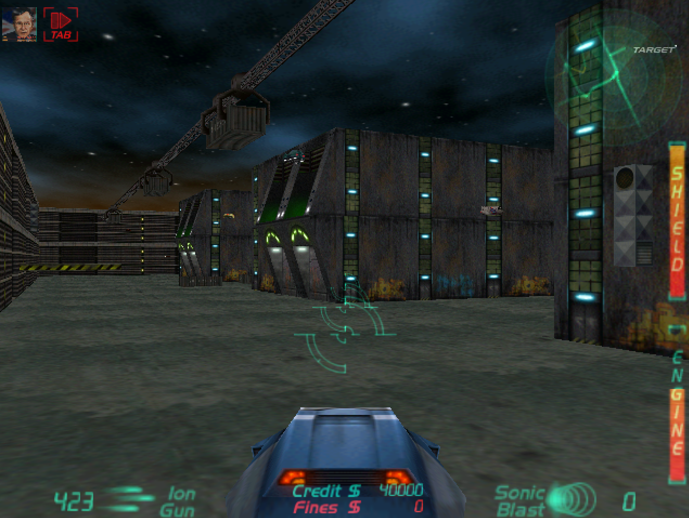

# BHunter



A source restoration of **BHunter**, the 1999 hovercar combat game by **InterActive Vision**, published by **Midas Interactive Entertainment**. Hunt criminals through a futuristic city and collect their bounties. [Original game details](https://gamefaqs.gamespot.com/pc/250530-bhunter/data).

## Install

1. Download and extract [release 0.1](https://github.com/stellarwind/BHunter-revived/releases/tag/v0.1) on Windows.
2. Copy `Bhunter.bin` from your own original game into the `GAME_DATA` folder.
3. Run `play-hardware.cmd` or `play-software.cmd`.

Original game files are not included. DDrawCompat is bundled for modern Windows compatibility. This is an early playable release; full original-game fidelity is still being reviewed.

## Build

Requires Python 3.10+, Visual C++ 5.0 with Visual Studio 97 SP3, and the DirectX 7 SDK. Proprietary build dependencies are not included.

Set these paths in a Command Prompt:

```bat
set BH_VC_ROOT=C:\VC5\VC
set BH_SP3_ROOT=C:\VS97SP3\all\vc
set BH_SHARED_DIR=C:\VC5\SHAREDIDE\BIN
set BH_DXSDK_ROOT=C:\DX7SDK
set BH_COMPILER_DIR=C:\BHunter-compiler
```

Prepare `BH_COMPILER_DIR` with stock VC5 `CL.EXE`, SP3 `c1.dll`, `c1xx.dll`, `c2.exe` (from `enu\vc\bin`), and stock `MSDIS100.DLL`, `MSPDB50.DLL`, `MSVCP50.DLL` (from `SHAREDIDE\BIN`). The build uses the stock VC5 linker and SP3 headers/libraries.

```bat
build-source.cmd
python tools\prepare_ddrawcompat.py
play-hardware.cmd
```

Keep your `Bhunter.bin` in `GAME_DATA`. To create a release ZIP:

```bat
python tools\package_release.py --version 0.1
```

## License

Restoration code: [MIT](LICENSE). Original game assets remain the property of their respective owners. Bundled [DDrawCompat](https://github.com/narzoul/DDrawCompat/tree/v0.7.2) has its own license, included in the release.
