# BHunter

<p align="center">
  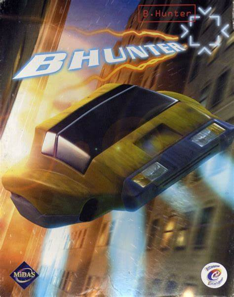
</p>

<table>
  <tr>
    <td align="center"><a href="media/1.webp">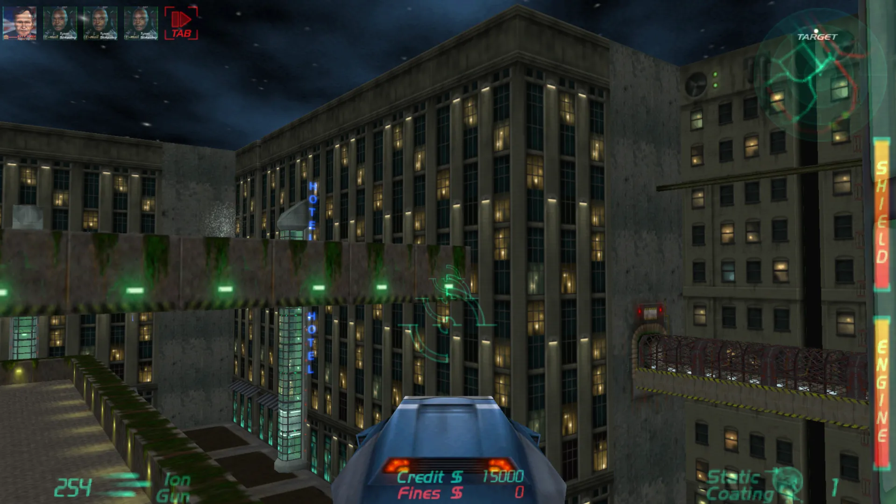</a></td>
    <td align="center"><a href="media/2.webp">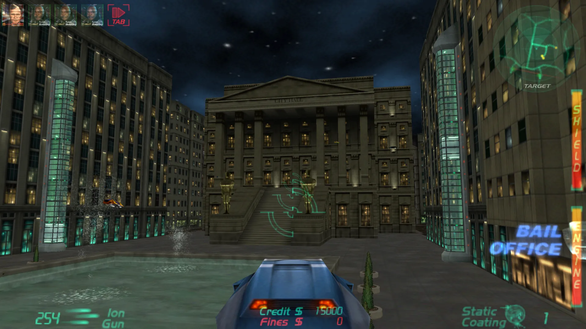</a></td>
    <td align="center"><a href="media/3.webp">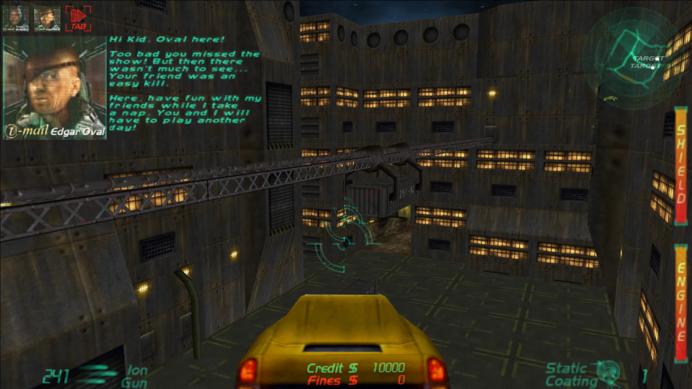</a></td>
  </tr>
  <tr>
    <td align="center"><a href="media/4.webp">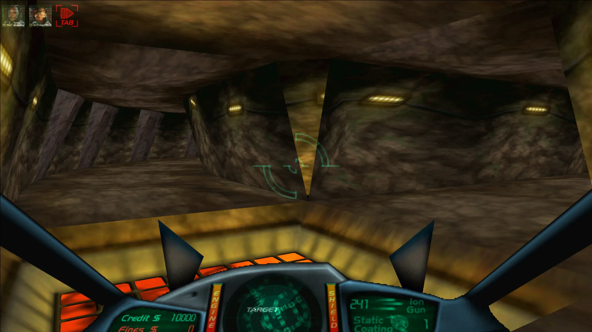</a></td>
    <td align="center"><a href="media/5.webp">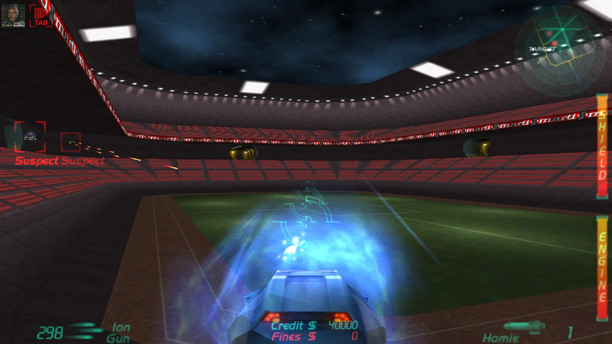</a></td>
    <td align="center"><a href="media/6.webp">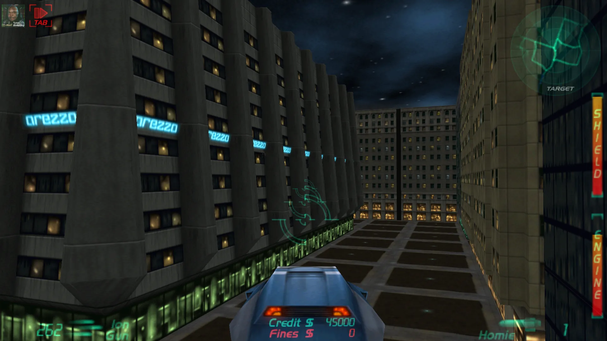</a></td>
  </tr>
  <tr>
    <td align="center"><a href="media/7.webp">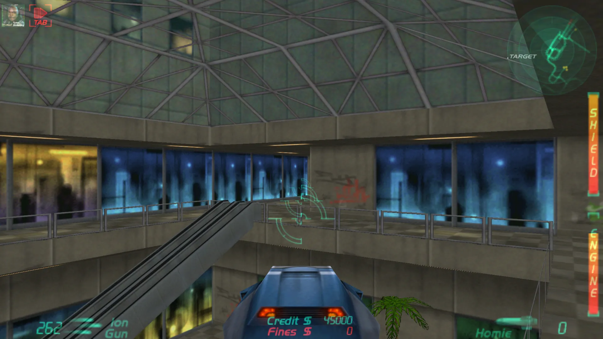</a></td>
    <td align="center"><a href="media/8.webp">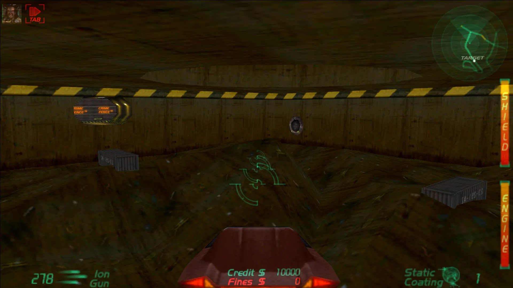</a></td>
    <td align="center"><a href="media/9.webp">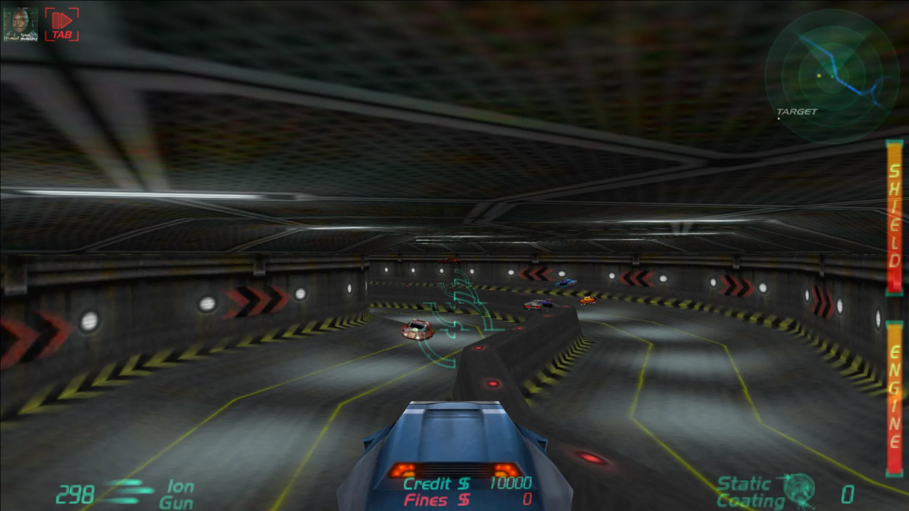</a></td>
  </tr>
  <tr>
    <td align="center"><a href="media/10.webp">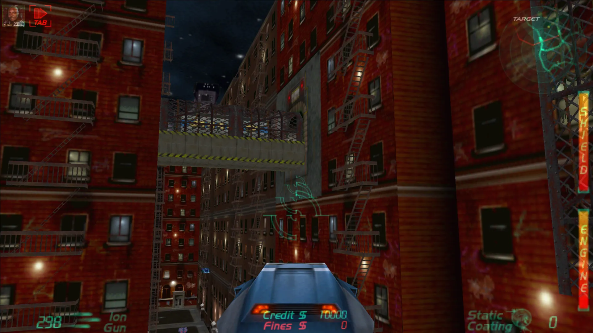</a></td>
    <td align="center"><a href="media/11.webp">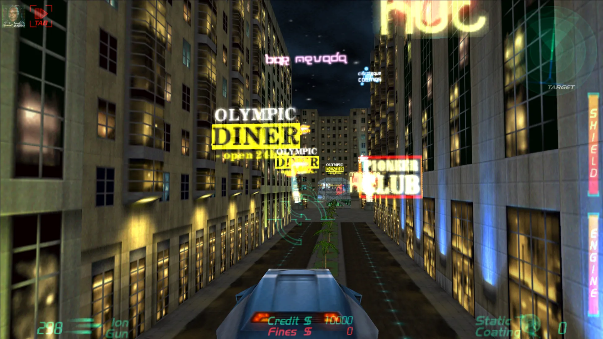</a></td>
    <td align="center"><a href="media/12.webp">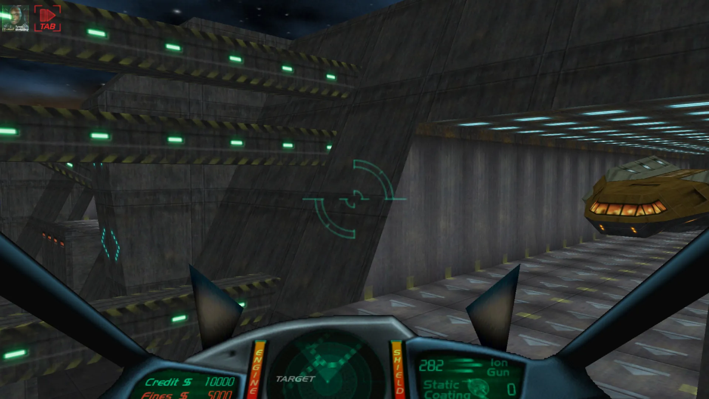</a></td>
  </tr>
  <tr>
    <td align="center"><a href="media/13.webp">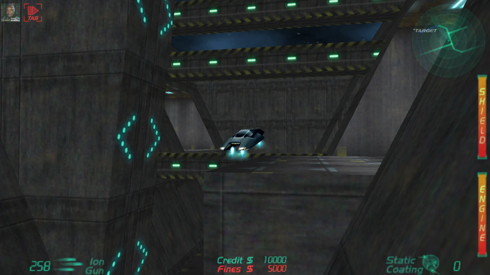</a></td>
    <td align="center"><a href="media/14.webp">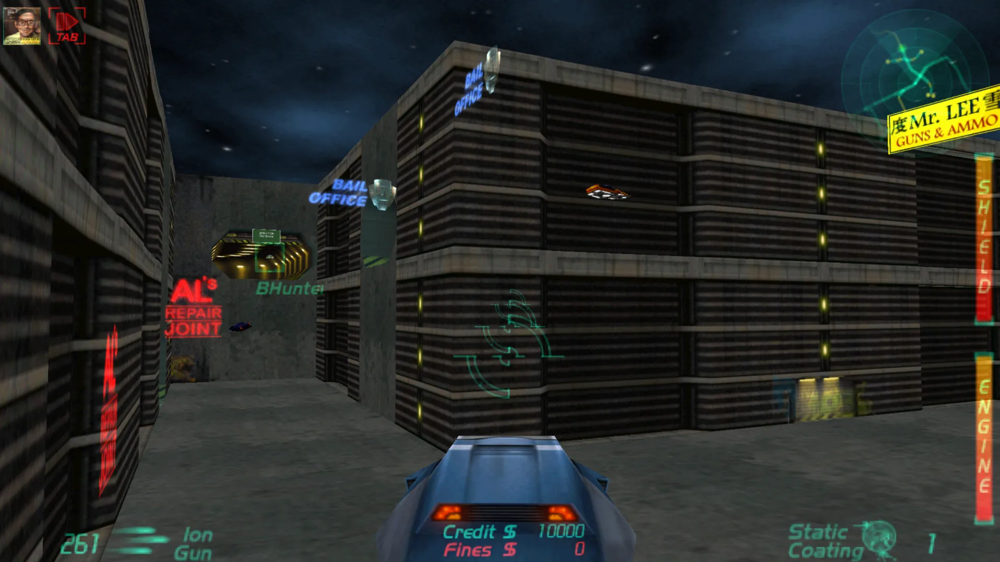</a></td>
    <td align="center"><a href="media/15.webp">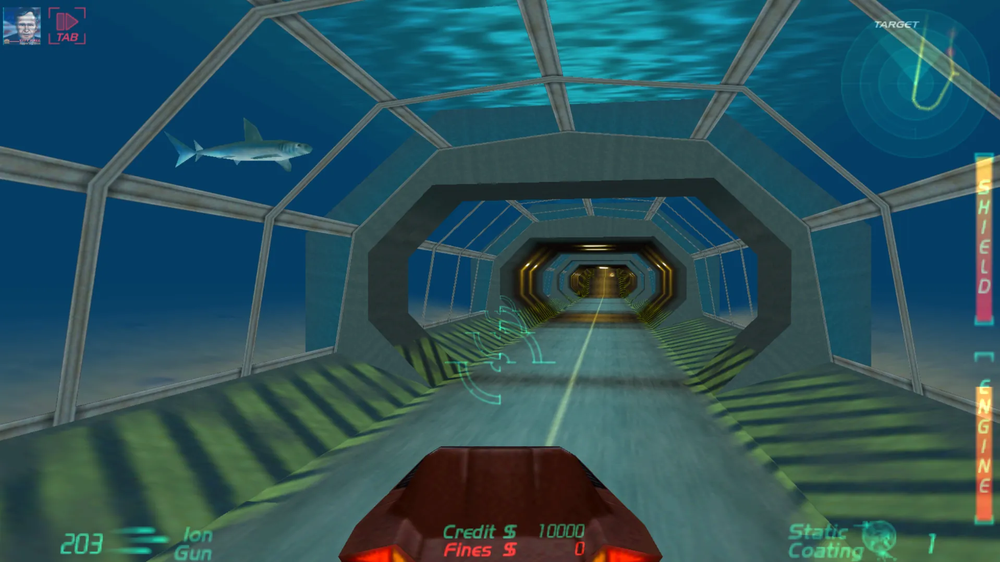</a></td>
  </tr>
</table>

A source restoration of **BHunter**, the 1999 hovercar combat game by **InterActive Vision**, published by **Midas Interactive Entertainment**. Hunt criminals through a futuristic city and collect their bounties. [Original game details](https://gamefaqs.gamespot.com/pc/250530-bhunter/data).

## Features

- SDL powered window management, hardware rendering, input and audio.
- 60fps, interpolated from 30.
- Up to 4k resolution with 4:3, 16:9, 21:9, and 16:10 aspect ratios.
- Gamepad support

## Install

1. Download and extract the [latest BHunter release](https://github.com/stellarwind/BHunter-revived/releases/latest) on Windows.
2. Create a `GAME_DATA` folder beside the executable and copy `Bhunter.bin` from your own original game into it.
3. Run `BHunter-source.exe`.

Music plays from `MUSIC_DATA/track02.wav` beside `GAME_DATA` (the extracted PCM WAV of CD track two, without the pregap). Extract the track from your own disc; mounted-CD playback is no longer used. Game volume controls affect only BHunter.

Supported original game: **BHunter, English retail PC edition (1999)**. The tested files are:

| File | SHA-256 |
|---|---|
| `Bhunter.bin` | `2393a661fd647ed6de3eee34c35c30812c44f3ee15b9d44244a63720804df581` |
| `BHUNTER.EXE` (reference only) | `c86205e299119a66e27f687679ee7e978f26fa9a6c0bfb21f664aa6e74e848b1` |

See [How to play](HOWTOPLAY.md) for controls.

## Build

Requires Python 3.10+ and a **32-bit MinGW-w64 GCC toolchain** with `gcc` and `g++` on PATH. SDL3 is downloaded automatically on the first build.

Place your original `Bhunter.bin` in `GAME_DATA` or `build/GAME_DATA`, then run:

```bat
tools\build.cmd
build\BHunter-source.exe
```

The game and required DLLs are written directly to `build/`. Keep them together when moving the game.

### Native Linux build

The game builds for 32-bit x86. Install GCC and G++ with 32-bit C and C++ libraries, 32-bit SDL3 development files, Python 3.10+, and `pkg-config` configured to find the 32-bit SDL3 package. Running the game requires a 32-bit Vulkan loader and driver.

Place `Bhunter.bin` in `GAME_DATA` as above, then run:

```sh
python3 tools/build_gcc.py --incremental
./build/linux-x86/BHunter-source
```

## AI disclaimer

This source restoration was decompiled, reconstructed and built with the assistance of OpenAI Codex. It is an unofficial restoration; exact original-game behavior is still being reviewed.

## License

Restoration code: [MIT](LICENSES/LICENSE). Original game assets remain the property of their respective owners. Bundled [SDL3](https://github.com/libsdl-org/SDL/tree/release-3.4.18) uses the zlib license, included in the release.
