# BHunter

<p align="center">
  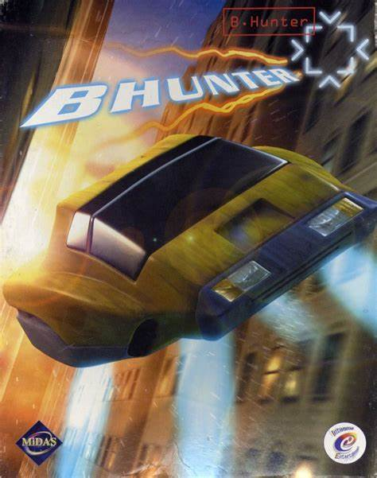
</p>

<table>
  <tr>
    <td align="center"><a href="screenshots/1.png">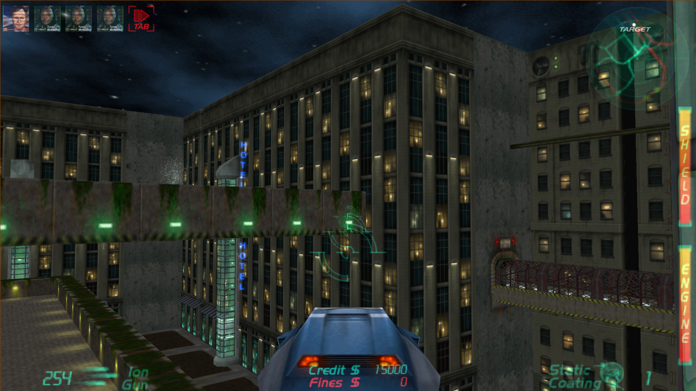</a></td>
    <td align="center"><a href="screenshots/2.png">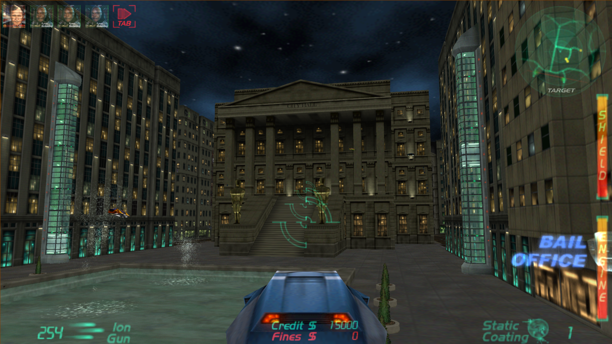</a></td>
    <td align="center"><a href="screenshots/3.png">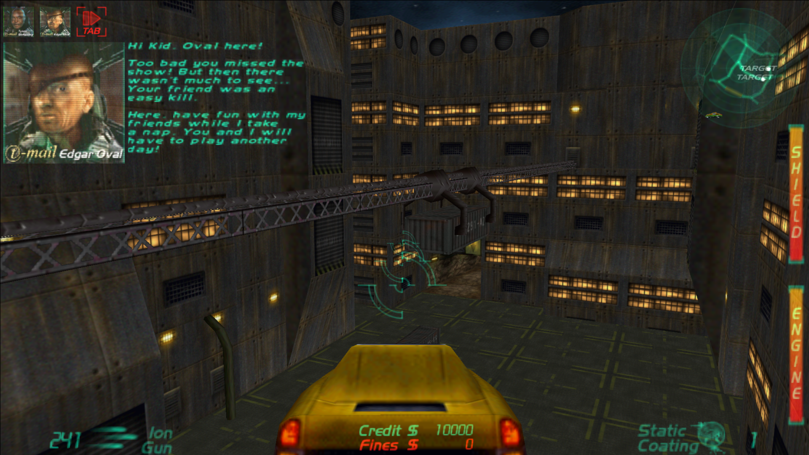</a></td>
  </tr>
  <tr>
    <td align="center"><a href="screenshots/4.png">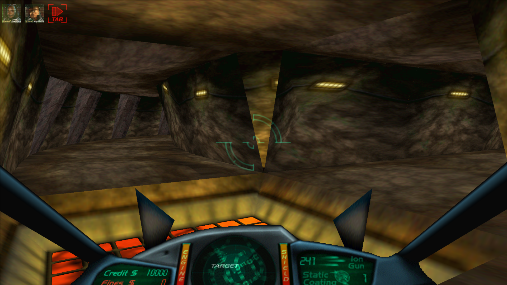</a></td>
    <td align="center"><a href="screenshots/5.png">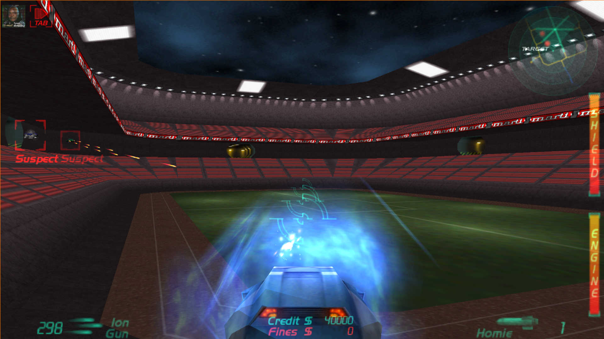</a></td>
    <td align="center"><a href="screenshots/6.png">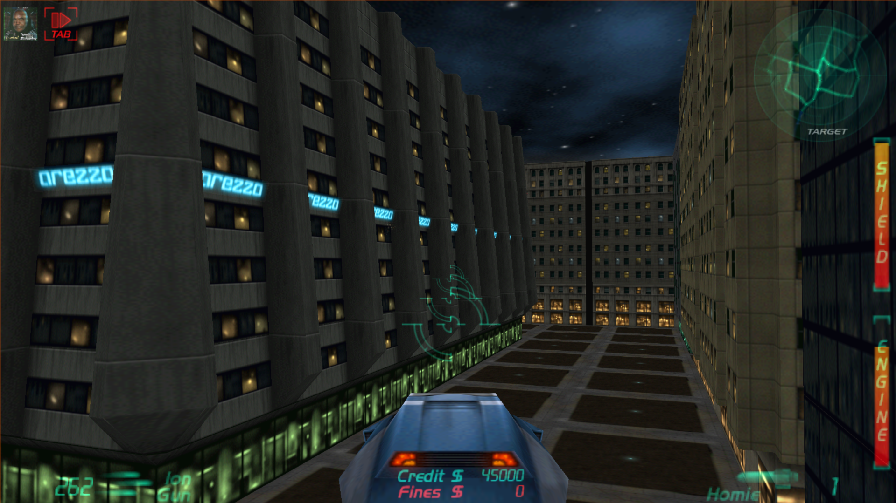</a></td>
  </tr>
  <tr>
    <td align="center"><a href="screenshots/7.png">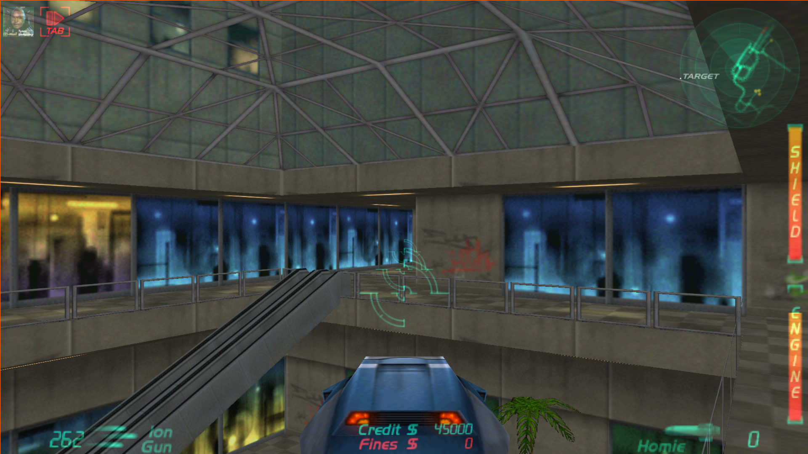</a></td>
    <td align="center"><a href="screenshots/8.png">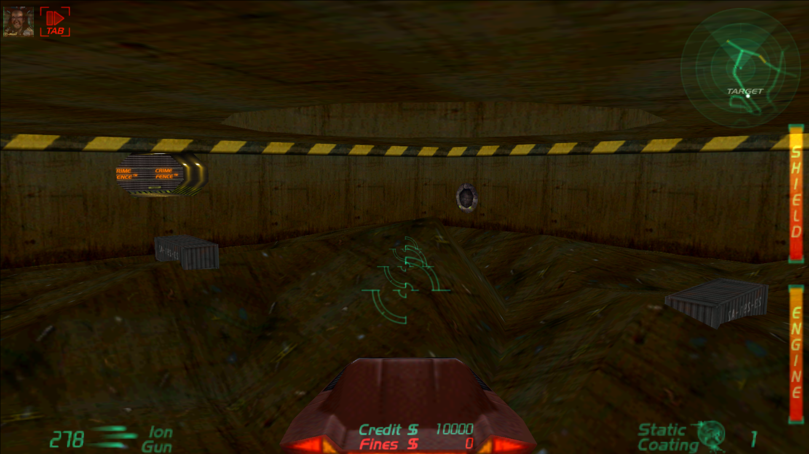</a></td>
    <td align="center"><a href="screenshots/9.png">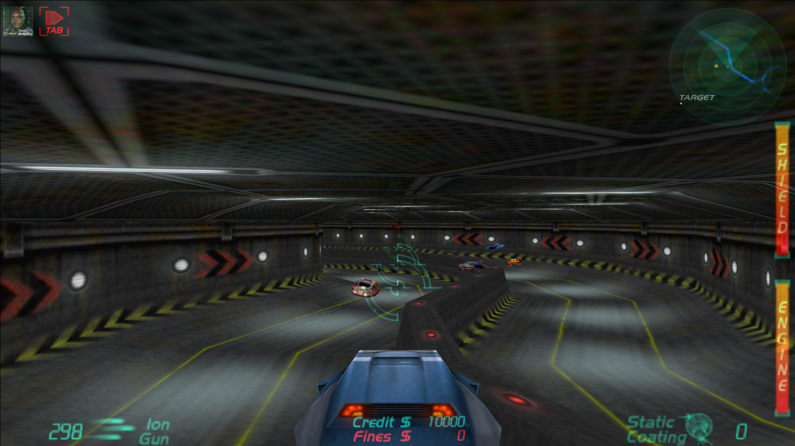</a></td>
  </tr>
  <tr>
    <td align="center"><a href="screenshots/10.png">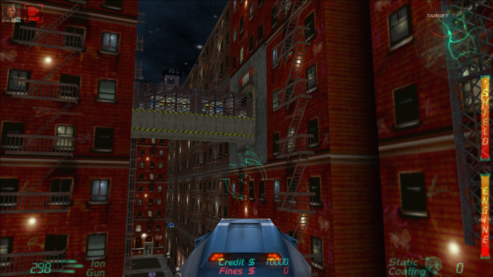</a></td>
    <td align="center"><a href="screenshots/11.png">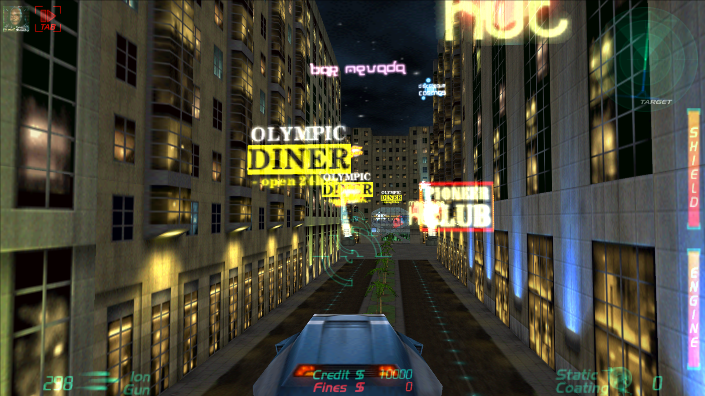</a></td>
    <td align="center"><a href="screenshots/12.png">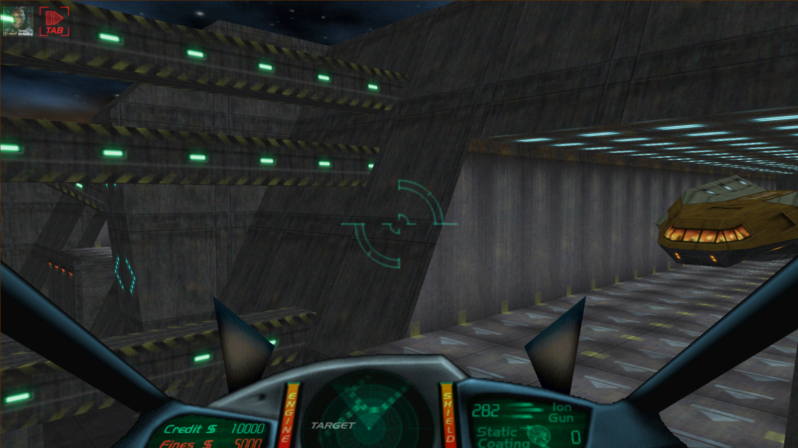</a></td>
  </tr>
  <tr>
    <td align="center"><a href="screenshots/13.png">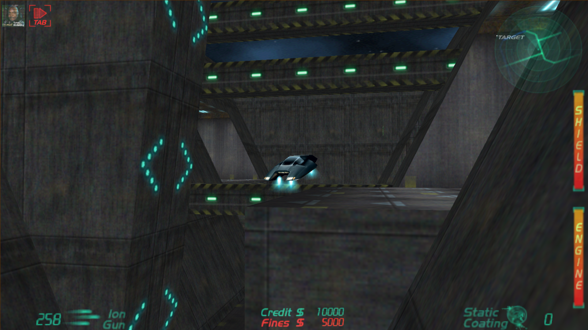</a></td>
    <td align="center"><a href="screenshots/14.png">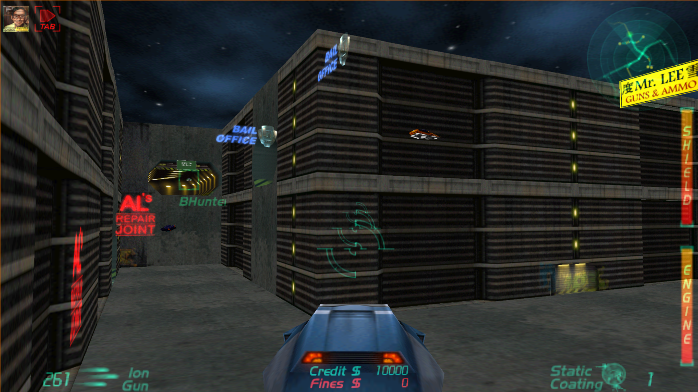</a></td>
    <td align="center"><a href="screenshots/15.png">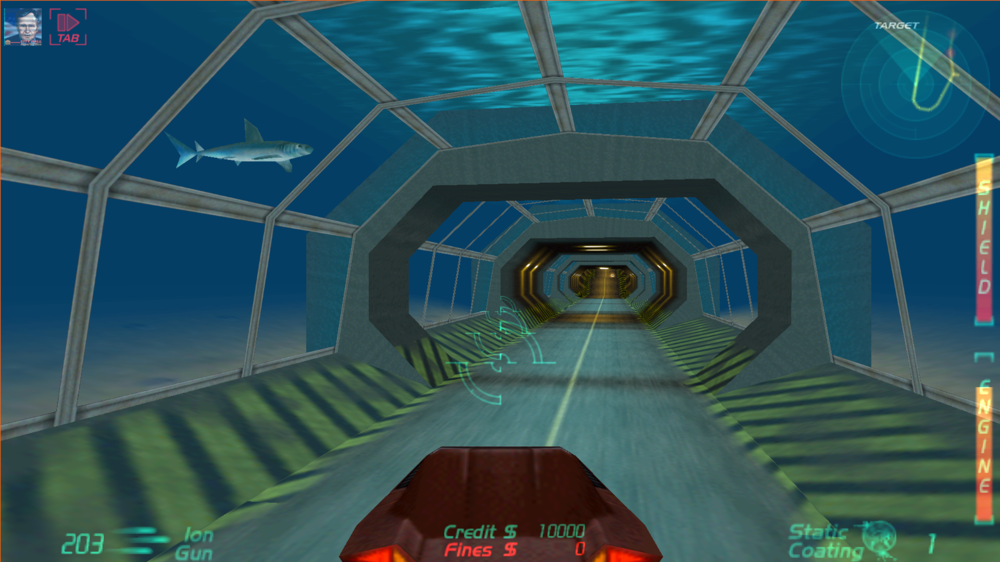</a></td>
  </tr>
</table>

A source restoration of **BHunter**, the 1999 hovercar combat game by **InterActive Vision**, published by **Midas Interactive Entertainment**. Hunt criminals through a futuristic city and collect their bounties. [Original game details](https://gamefaqs.gamespot.com/pc/250530-bhunter/data).

## Features

- SDL powered window management, hardware rendering and input.
- 60fps, interpolated from 30.
- Up to 4k resolution, 4:3, 16:9, 21:9 aspect ratios
- Gamepad support

## Install

1. Download and extract [release 0.2](https://github.com/stellarwind/BHunter-revived/releases/tag/v0.2) on Windows.
2. Copy `Bhunter.bin` from your own original game into the `GAME_DATA` folder.
3. Run `BHunter-source.exe`.

Music plays from a mounted BHunter CD, or from `MUSIC_DATA/track02.wav` beside `GAME_DATA`. 

Supported original game: **BHunter, English retail PC edition (1999)**. The tested files are:

| File | SHA-256 |
|---|---|
| `Bhunter.bin` | `2393a661fd647ed6de3eee34c35c30812c44f3ee15b9d44244a63720804df581` |
| `BHUNTER.EXE` (reference only) | `c86205e299119a66e27f687679ee7e978f26fa9a6c0bfb21f664aa6e74e848b1` |

See [How to play](HOWTOPLAY.md) for controls.

## Build

Requires Python 3.10+, Visual C++ 5.0 with Visual Studio 97 SP3, the DirectX 7 SDK headers/DirectInput library, and a 32-bit MinGW-w64 C++17 compiler (`g++` on PATH, or `BH_GPU_CXX`). Proprietary build dependencies are not included.

Set these paths in a Command Prompt:

```bat
set BH_VC_ROOT=C:\VC5\VC
set BH_SP3_ROOT=C:\VS97SP3\all\vc
set BH_SHARED_DIR=C:\VC5\SHAREDIDE\BIN
set BH_DXSDK_ROOT=C:\DX7SDK
set BH_COMPILER_DIR=C:\BHunter-compiler
```

Prepare `BH_COMPILER_DIR` with stock VC5 `CL.EXE`, SP3 `c1.dll`, `c1xx.dll`, `c2.exe` (from `enu\vc\bin`), and stock `MSDIS100.DLL`, `MSPDB50.DLL`, `MSVCP50.DLL` (from `SHAREDIDE\BIN`). The build uses the stock VC5 linker and SP3 headers/libraries.

```bat
build-source.cmd
build\BHunter-source.exe
```

## Unlock all levels

Quit the game, then run with Python 3.10+:

```bat
python tools\unlock_levels.py
```

This unlocks all nine mission entries in `source-preview.cfg` beside the executable (`build/source-preview.cfg` for local builds), backing up the save before changing it.

## AI disclaimer

This source restoration was decompiled, reconstructed and built with the assistance of OpenAI Codex. It is an unofficial restoration; exact original-game behavior is still being reviewed.

## License

Restoration code: [MIT](LICENSE). Original game assets remain the property of their respective owners. Bundled [SDL3](https://github.com/libsdl-org/SDL/tree/release-3.4.18) uses the zlib license, included in the release.
